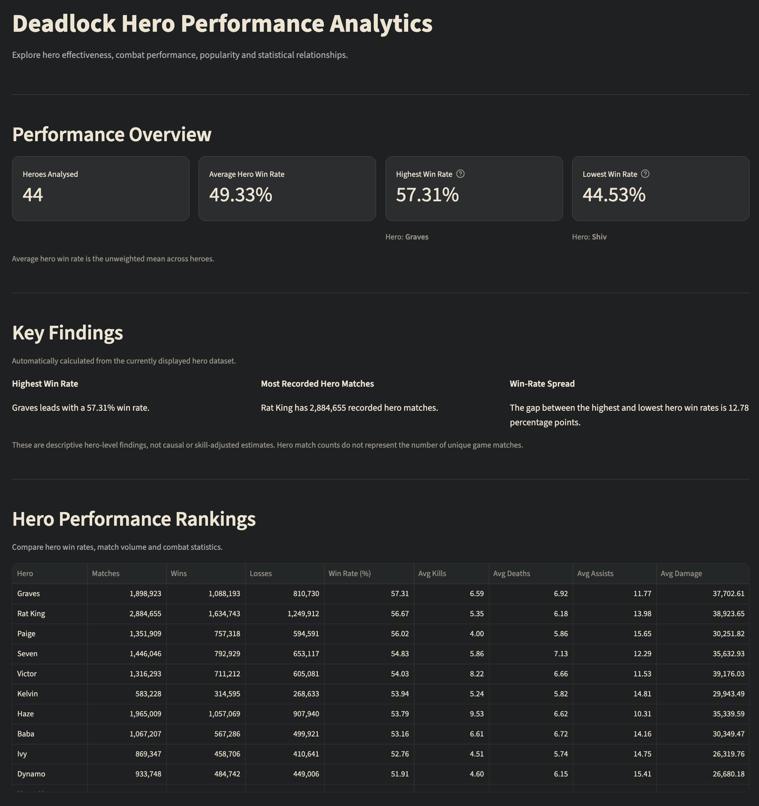
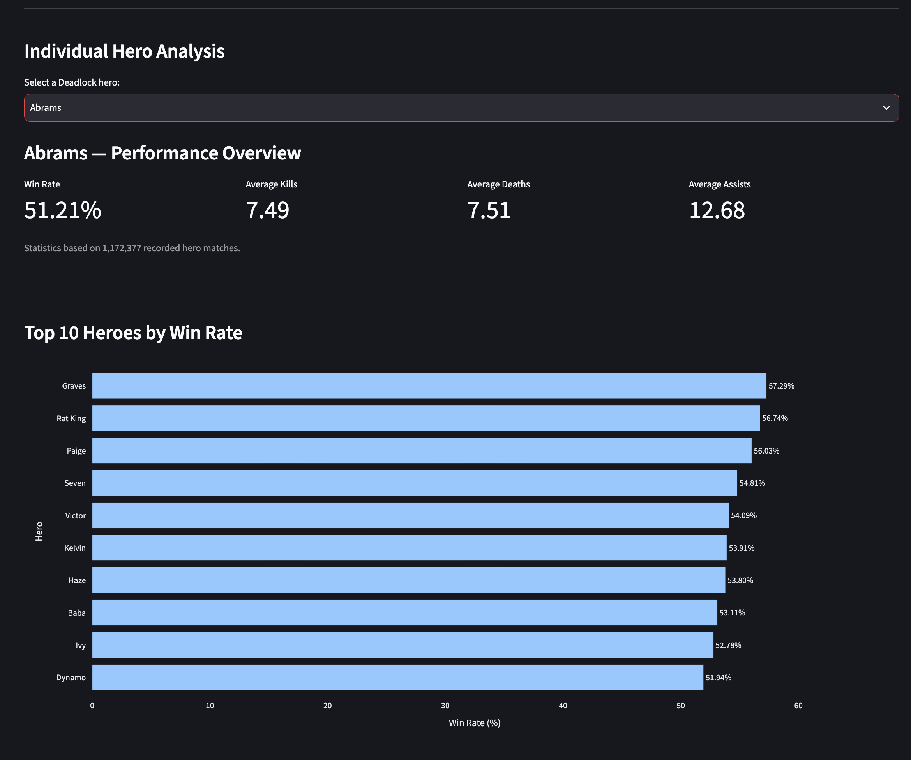
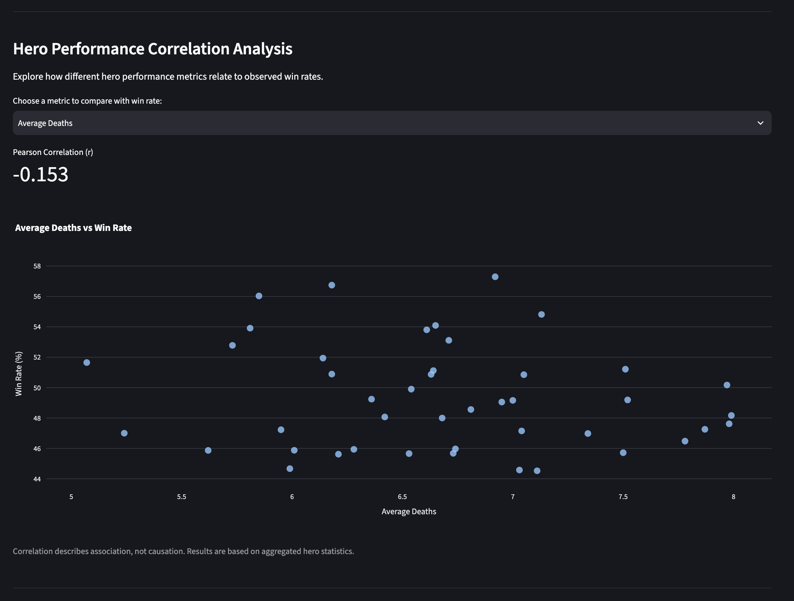
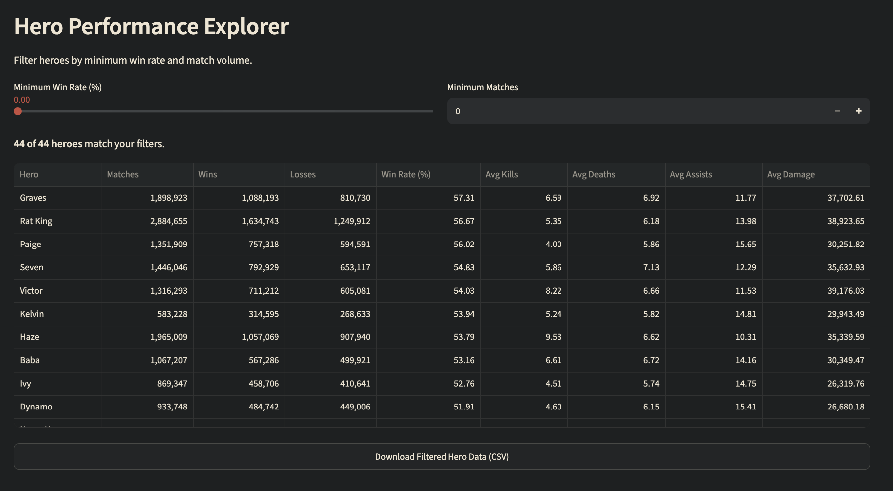

# Deadlock Hero Performance Analytics Dashboard

**An end-to-end Python analytics project examining hero performance, gameplay statistics and game balance in Valve's *Deadlock*.**

[**Live Streamlit dashboard**](https://deadlock-hero-analytics-np.streamlit.app/) · **Deployment undergoing verification** (the new Cloud deployment was still starting when this README was prepared)

This portfolio project combines REST API ingestion, data validation, feature engineering, exploratory analysis, automated tests, scheduled GitHub Actions updates and an interactive Streamlit dashboard.

> **Repository visibility:** This repository is currently private. The dashboard URL is separate from repository access.

## Project overview

The dashboard makes aggregated hero-level statistics easier to explore and compare. It addresses five questions:

1. Which heroes have the highest and lowest recorded win rates?
2. How is recorded hero match volume associated with win rate?
3. Is average kill count associated with higher hero win rates?
4. How do average deaths, assists and player damage relate to win rate?
5. How can interactive visualisations help users compare hero performance?

## Dashboard features

- **Performance overview:** hero count, mean hero win rate and win-rate range.
- **Hero rankings:** sortable table of matches, wins, losses and combat averages.
- **Individual hero analysis:** select a hero to inspect its performance metrics.
- **Top 10 win rates:** interactive horizontal bar chart.
- **Correlation explorer:** compare win rate against match volume, kills, deaths, assists or damage, with Pearson's *r*.
- **Interactive filters:** set minimum win rate and match count, then download filtered results as CSV.
- **Deadlock-inspired design:** charcoal background, rust-red accents and ivory text.
- **Data refresh:** a six-hour scheduled GitHub Actions pipeline and a separate six-hour Streamlit API cache/refresh mechanism, with a local CSV fallback.

### Dashboard screenshots

*These screenshots illustrate the dashboard layout; values may differ from refreshed API results.*

**Overview and hero statistics**



**Individual hero analysis and win-rate rankings**



**Correlation analysis**



**Hero performance explorer**



## Technology stack

| Technology | Role |
| --- | --- |
| Python 3.12 | Data pipeline and application logic |
| Pandas | Validation, transformation and analysis |
| Requests | Deadlock REST API access |
| Plotly | Interactive charts |
| Streamlit | Web dashboard |
| pytest | Automated validation tests |
| GitHub Actions | Scheduled data ingestion and tests |
| Git / GitHub | Version control and project hosting |
| VS Code | Local development |

## Data sources and pipeline

The project uses the community-maintained Deadlock API:

- **Hero statistics:** `https://api.deadlock-api.com/v1/analytics/hero-stats`
- **Hero metadata:** `https://api.deadlock-api.com/v1/assets/heroes`

The local and GitHub Actions pipeline consists of:

1. **Extract** — `src/api_client.py` requests aggregated hero statistics and stores a timestamped raw JSON snapshot.
2. **Transform and validate** — `src/data_processing.py` checks hero identifiers, positive match counts and consistency between wins, losses and matches; it calculates derived metrics and exports a CSV.
3. **Enrich** — `src/add_hero_names.py` joins hero metadata by ID and checks for unmatched names.
4. **Orchestrate** — `src/run_pipeline.py` runs the three stages in sequence.

### Derived metrics

| Metric | Formula |
| --- | --- |
| Win rate (%) | `wins / matches * 100` |
| Average kills | `total_kills / matches` |
| Average deaths | `total_deaths / matches` |
| Average assists | `total_assists / matches` |
| Average player damage | `total_player_damage / matches` |
| Appearance share (%) | `hero matches / sum of all hero match counts * 100` |

**Appearance share is not a true match-level pick rate.** It represents the relative distribution of hero match counts in this aggregated dataset.

### Automated refresh

The workflow `.github/workflows/update-data.yml` runs on a six-hour UTC schedule (nominally **00:17, 06:17, 12:17 and 18:17 UTC**) and can also be started manually. It:

1. Installs dependencies on Python 3.12.
2. Runs the extraction, transformation and enrichment pipeline.
3. Runs the automated test suite.
4. Commits `data/processed/hero_performance.csv` to `main` **only if the file changed**.

GitHub Actions schedules can be delayed. The deployed Streamlit app separately requests current API data on a six-hour cache/refresh cycle; it does **not** need a public URL to this private repository. Its **Last Updated** timestamp indicates when data was retrieved, not when the underlying gameplay statistics last changed. If the API is unavailable, the app can fall back to its bundled processed CSV.

## Exploratory findings

The following results refer specifically to the **1 November 2026 snapshot (44 heroes)**. They are historical observations, **not** live rankings.

### Highest recorded win rates

| Rank | Hero | Win rate |
| ---: | --- | ---: |
| 1 | Graves | 57.29% |
| 2 | Rat King | 56.75% |
| 3 | Paige | 56.03% |
| 4 | Seven | 54.81% |
| 5 | Victor | 54.09% |

### Associations with win rate

- **Recorded hero matches vs. win rate:** Pearson *r* ≈ **+0.479**, a moderate positive linear association in this snapshot.
- **Average kills vs. win rate:** Pearson *r* ≈ **−0.064**, little linear association in this snapshot.

These are descriptive, hero-level correlations. They do not establish causation or account for player skill, team composition, patches or other confounders.

### Limitations

- Data are aggregated by hero, not individual match or player.
- The API's aggregation window, game modes and inclusion rules may affect comparisons.
- Hero match counts do not equal the number of unique matches played.
- Balance updates and changing player behaviour can alter rankings over time.
- Correlations are descriptive and cannot isolate causal effects.
- The dashboard's retrieval timestamp is not a guarantee of source-data freshness.

## Run locally

**Prerequisites:** Python 3.12, Git and an internet connection for fresh API requests.

```bash
# Clone requires authorization while the repository is private
git clone https://github.com/naisyap/deadlock-hero-analytics.git
cd deadlock-hero-analytics

# Create and activate a virtual environment
python3 -m venv .venv
source .venv/bin/activate

# Install packages
python -m pip install -r requirements.txt

# Optional: refresh the local processed CSV
python src/run_pipeline.py

# Launch the dashboard
python -m streamlit run app.py
```

On Windows, activate the environment using `.venv\Scripts\activate` instead. Streamlit normally serves the local dashboard at `http://localhost:8501`.

### Run tests

```bash
python -m pytest tests/ -v
```

The project has **nine data validation tests**, covering dataset completeness, required columns, unique IDs, hero names, positive match counts, win/loss consistency, valid win rates and selected metric calculations. All nine passed in the local verification recorded on 1 November 2026.

## Project structure

```text
deadlock-hero-analytics/
├── .github/
│   └── workflows/
│       └── update-data.yml
├── .streamlit/
│   └── config.toml
├── analysis/
│   ├── hero_analysis.py
│   ├── win_rate_chart.py
│   ├── popularity_vs_winrate.py
│   └── kills_vs_winrate.py
├── assets/
│   ├── dashboard-overview.png
│   ├── hero-analysis-winrate-rankings.png
│   ├── hero-correlation-analysis.png
│   └── hero-performance-explorer.png
├── data/
│   ├── processed/
│   │   └── hero_performance.csv
│   └── raw/                    # Local snapshots; ignored by Git
├── docs/
│   └── project_brief.md
├── outputs/
│   └── figures/               # Generated figures; ignored by Git
├── src/
│   ├── api_client.py
│   ├── inspect_data.py
│   ├── data_processing.py
│   ├── add_hero_names.py
│   └── run_pipeline.py
├── tests/
│   └── test_hero_data.py
├── app.py
├── requirements.txt
├── .gitignore
└── README.md
```

## Future improvements

- Record historical snapshots to analyse hero trends across dates and balance patches.
- Add API-failure and transformation-edge-case tests.
- Expand data-quality reporting and monitoring.
- Add contextual comparisons across game versions or other supported API dimensions.
- Verify the deployed dashboard's accessibility, theme and scheduled refresh behaviour.

## Disclaimer

This is an independent educational and portfolio project, not affiliated with, endorsed by or sponsored by Valve. *Deadlock* and associated game assets belong to their respective rights holders.
